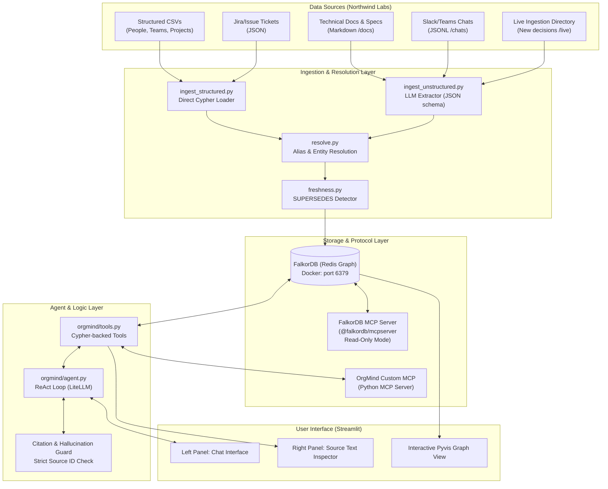

# OrgMind Architecture (Company Brain)

> **Plain-English Overview**: OrgMind is an intelligent assistant for a company. Think of it as a corporate memory system. Instead of searching through separate Slack channels, Google Docs, and Jira tickets, OrgMind collects all company knowledge into a single **Knowledge Graph** (a network of interconnected data points). It connects who works on what, who knows what, why decisions were made, and points back to the exact paragraph or chat message where every fact came from.

---

## 1. Glossary of Technical Terms (Simple Definitions)

* **Knowledge Graph**: A database format where information is stored as **Nodes** (things or entities, like people, projects, documents) and **Edges / Relationships** (the arrows connecting them, like "AUTHORED" or "OWNS").
* **Cypher**: A pattern-matching query language used for graph databases, similar to what SQL is for relational databases. For example: `MATCH (p:Person)-[:OWNS]->(proj:Project) RETURN p, proj`.
* **FalkorDB**: A graph database built as a Redis module. It stores graph data in adjacency matrices (linear algebra) in memory, making Cypher queries very fast.
* **MCP (Model Context Protocol)**: An open standard created by Anthropic that lets an AI model query external systems (like databases, APIs, or local tools) in a secure, uniform way.
* **LiteLLM**: A lightweight Python library that gives you a single unified format to call any Large Language Model (OpenAI, Anthropic Claude, Google Gemini, Ollama, etc.) using standard functions.
* **Provenance**: The audit trail of where a piece of information originated (its exact source document, message, or ticket).
* **Superseding**: Replacing an older rule or decision with a newer one, without deleting the historical record.
* **Entity Resolution**: The process of figuring out that "Alice", "@alice.chen", and "Alice C." in different chats refer to the same person.

---

## 2. Component Architecture

---

## 3. Tech Stack Breakdown & Trade-offs

| Component | Choice | Reason & Trade-offs |
| :--- | :--- | :--- |
| **Graph DB** | **FalkorDB** (Docker `falkordb/falkordb:latest`) | **Pros**: In-memory Redis engine, very fast graph traversals, native Cypher support, official Docker image. **Cons**: Does not support full Neo4j APOC plugins or full OpenCypher regex; requires careful query construction. |
| **Python DB Client** | `falkordb` | Native Redis-based Python client for executing Cypher against FalkorDB with minimal overhead. |
| **MCP Integration** | `@falkordb/mcpserver` + custom Python MCP | **Official FalkorDB MCP**: Used for schema discovery and read-only ad-hoc graph inspection. **Custom Python MCP**: Wraps our deterministic company tools (`who_owns`, `trace_decision`, etc.) to guarantee clean, verified tool calls. |
| **LLM Router** | **LiteLLM** | **Pros**: Drop-in provider swap (`openai/gpt-4o`, `anthropic/claude-3-5-sonnet`, `gemini/gemini-1.5-pro`, or `ollama/llama3`). Single environment variable switch. **Cons**: Tiny layer overhead, but provides standard OpenAI-compatible tool call formatting. |
| **Extraction Engine** | Custom JSON-Schema Extractor | **Pros**: Deterministic, strict Pydantic models, handles source offsets (`Source` nodes) with 100% control. **FalkorDB GraphRAG-SDK**: Evaluated as an optional shortcut (see below). |
| **Frontend UI** | **Streamlit + Pyvis** | Fast 36-hour hackathon UI: 2-column layout (Chat on the left, Verified Sources on the right) with an interactive Pyvis HTML network graph visualization. |

---

## 4. GraphRAG-SDK: What It Does & When to Skip

* **What it does**: FalkorDB's `graphrag-sdk` is an official library that takes raw text, uses an LLM to automatically infer entities and relationships, creates them in FalkorDB, and provides a question-answering pipeline.
* **Why we use our custom extractor as primary**:
  1. Our hackathon requirements demand strict provenance (`Source` node with exact text chunk, offset, and file origin) and deterministic status fields (`status: 'current' | 'superseded'`).
  2. Entity resolution (mapping chat handles like `@alex` to `Alex Mercer`) needs company-specific fuzzy matching.
  3. We must enforce the `SUPERSEDES` timeline for decisions. Generic extractors often hallucinate arbitrary edge names or overwrite nodes instead of linking superseding decisions.
* **When to try GraphRAG-SDK**: Timebox to **3 hours max** during Day 2 only if structured ingestion is finished and we want experimental automated semantic search over freeform whitepapers. Skip immediately if it conflicts with our schema contracts.

---

## 5. Security & Read-Only Guarantees

1. **FalkorDB MCP Read-Only Mode**: Configured with `FALKORDB_DEFAULT_READONLY=true` and using `query_graph_readonly` to guarantee that the LLM cannot run `DELETE` or unauthorized mutations directly via MCP.
2. **Action Tools Simulation**: Actions like `create_ticket`, `draft_message`, and `assign_task` update our graph with `status: 'simulated_draft'` and return a preview to the user without touching real-world production systems.
3. **Citation Guard**: The agent prompt forces an explicit rule: if a fact does not have a linked `Source` ID in the graph response, the agent is forbidden from stating it as fact.
