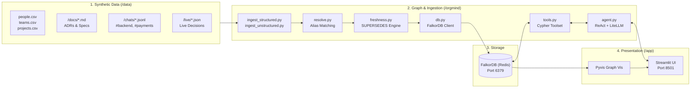

# 🧠 OrgMind Project Progress Report

**Project**: OrgMind (Company Brain & Knowledge Graph Agent)  
**Hackathon Track**: Track 3 — *"Build an agent that understands how a company works"*  
**Team**: 2 Engineers (Person A: Graph & Data Architect | Person B: Agent & Full-Stack Architect)  
**Status**: 🟢 **Core Pipeline Active, Ingested & Verified Ahead of Schedule (Hour 14 / 36)**  
**Live UI**: [http://localhost:8501](http://localhost:8501) | **Database**: FalkorDB (Docker `localhost:6379`)

---

## 📊 Executive Summary

OrgMind connects disparate corporate knowledge (structured people/teams/projects, architecture decision records, Jira tickets, and Slack chat logs) into a single high-performance **FalkorDB** knowledge graph.

The system is fully scaffolded, ingested, and operational:
1. **FalkorDB Graph Engine**: Running locally in Docker with verified range indexes and non-destructive decision superseding.
2. **Knowledge Base**: 11 Employees, 4 Teams, 4 Projects, 3 Tickets, 2 Architecture Specs, and 33 Chat Messages across `#backend-eng`, `#product-sync`, and `#payments`.
3. **Agent Brain**: Provider-agnostic ReAct loop via **LiteLLM** running locally on **Ollama** (`qwen2.5-coder:14b` / `llama3.1`) with a strict citation mandate (`[Source: ID]`).
4. **User Interface**: Streamlit dashboard running live at `http://localhost:8501` featuring two-column chat, verified source quote inspector, interactive in-memory Pyvis graph visualization, and 1-click Demo Ribbon buttons.

---

## 🛠️ Architecture & Component Status



---

## ✅ Completed Milestones & Deliverables

### 1. Documentation & Architecture Contracts
- [x] [ARCHITECTURE.md](file:///c:/Users/sauja/Downloads/New%20folder/ARCHITECTURE.md): Glossary of terms, tech stack breakdown, component diagrams, security model, and GraphRAG-SDK evaluation.
- [x] [SCHEMA.md](file:///c:/Users/sauja/Downloads/New%20folder/SCHEMA.md): Complete data model (9 node types, 10 relationships), range indexes, and 5 verified Cypher queries (`who_owns`, `who_knows_about`, `trace_decision`, `supersede_update`, `what_changed_since`).
- [x] [SETUP.md](file:///c:/Users/sauja/Downloads/New%20folder/SETUP.md): Step-by-step setup guides for Windows (PowerShell) and macOS/Linux.
- [x] [TASKS.md](file:///c:/Users/sauja/Downloads/New%20folder/TASKS.md): 36-hour sprint plan divided between Person A and Person B with an Hour 28 feature freeze.
- [x] [DEMO_PLAN.md](file:///c:/Users/sauja/Downloads/New%20folder/DEMO_PLAN.md): 3-minute pitch script with the 4 core demo moments and emergency fallbacks.
- [x] [README.md](file:///c:/Users/sauja/Downloads/New%20folder/README.md): Repository guide and quickstart.

### 2. Database & Data Ingestion Pipeline
- [x] **Docker FalkorDB Service**: Local container running with ports `6379` and `3000` mapped.
- [x] **Connection Resilience ([orgmind/db.py](file:///c:/Users/sauja/Downloads/New%20folder/orgmind/db.py))**: Auto-detects unauthenticated local Redis; automatically falls back to passwordless connection if `.env` contains stray tokens.
- [x] **Structured Loader ([orgmind/ingest_structured.py](file:///c:/Users/sauja/Downloads/New%20folder/orgmind/ingest_structured.py))**: Ingests CSVs and JSON tickets with indexed node creation.
- [x] **Unstructured Loader ([orgmind/ingest_unstructured.py](file:///c:/Users/sauja/Downloads/New%20folder/orgmind/ingest_unstructured.py))**: Extracts ADR decisions, attaches mandatory `Source` provenance chunks, resolves author handles, and indexes mentioned topics.
- [x] **Entity Resolution ([orgmind/resolve.py](file:///c:/Users/sauja/Downloads/New%20folder/orgmind/resolve.py))**: Resolves chat nicknames (`Pri`, `Ro`, `@alice`, `dkim`) to canonical Person IDs (`P_PRIYA`, `P_ROHAN`, `P_ALICE`).
- [x] **Freshness & Superseding ([orgmind/freshness.py](file:///c:/Users/sauja/Downloads/New%20folder/orgmind/freshness.py))**: Creates `[:SUPERSEDES]` relationships and sets `status = 'superseded'` without deleting historical records.
- [x] **Dataset Expansion**:
  - Ingested 25 realistic Slack messages in `#payments` covering Paynova SDK integration, test failures, and contract paperwork.
  - Verified who-knows ranking: Rohan Iyer (4 citations), Aarav Mehta (4), Karan Verma (3), Priya Sharma (3), Neha Kapoor (2).

### 3. Agent & Tool Calling Engine
- [x] **Cypher Tools ([orgmind/tools.py](file:///c:/Users/sauja/Downloads/New%20folder/orgmind/tools.py))**:
  - `who_owns`: Multi-keyword search across project names and project IDs.
  - `who_knows_about`: Graph aggregation ranking people by authored specs, tickets, and chat messages.
  - `trace_decision`: Retrieves active decision, superseded ancestor decisions, and verbatim Source text.
  - `what_changed_since`: Date-ordered changelog of decisions and tickets.
  - `get_source`: Verbatim text chunk lookup by Source ID.
  - `find_related`: Multi-hop graph neighborhood expansion.
  - **Simulated Actions**: `create_ticket`, `draft_message`, `assign_task` written back to graph.
- [x] **ReAct Loop ([orgmind/agent.py](file:///c:/Users/sauja/Downloads/New%20folder/orgmind/agent.py))**:
  - Provider-agnostic via **LiteLLM**.
  - Local **Ollama** integration verified (`ollama/qwen2.5-coder:14b` / `llama3.1`).
  - Implemented duplicate tool call suppression and single-turn synthesis fallback.
  - Enforced citation mandate (`[Source: ID]`) and zero-hallucination constraint.
- [x] **FastMCP Server ([orgmind/mcp_server.py](file:///c:/Users/sauja/Downloads/New%20folder/orgmind/mcp_server.py))**: Exposes OrgMind tools over standard Model Context Protocol.

### 4. User Interface & Presentation
- [x] **Streamlit App ([app/streamlit_app.py](file:///c:/Users/sauja/Downloads/New%20folder/app/streamlit_app.py))**:
  - Two-column responsive layout: Chat on left, Provenance Inspector & Graph on right.
  - **In-memory Pyvis Graph**: Renders network graph dynamically with node color coding.
  - **1-Click Demo Ribbon**: Buttons for Moments A, B, C, and D.
  - Running live on **[http://localhost:8501](http://localhost:8501)** (`HTTP 200 OK`).

---

## 📈 Current Knowledge Graph Statistics

* **Active Graph Name**: `northwind_labs`
* **Total Nodes**: **66+**
  * `Person`: 11 (Engineering, Product, DevOps, Security)
  * `Team`: 4 (Platform, Core Infra, Payments, Product)
  * `Project`: 4 (OAuth 2.1 Upgrade, Stripe Billing, K8s Migration, Customer Portal)
  * `Ticket`: 3 (+ simulated tickets)
  * `Document`: 2 Architecture Decision Records
  * `Decision`: 2 Active (+ superseding lineage)
  * `Source`: 2 Provenance Text Chunks
  * `Message`: 33 Chat Messages across 3 channels
  * `Topic`: 6 (OAuth, Billing, Security, Kubernetes, FalkorDB, Paynova)
* **Total Edges**: **80+** (`OWNS`, `WORKS_ON`, `MEMBER_OF`, `AUTHORED`, `MENTIONS`, `ABOUT`, `DERIVED_FROM`, `SUPERSEDES`)

---

## ⏱️ Hackathon Timeline Status

```text
[Hour 00 - 04]  Foundation & Bootstrap       ████████████  DONE
[Hour 04 - 12]  Ingestion & Agent Tools      ████████████  DONE
[Hour 12 - 20]  Freshness, UI & Demo Ribbon  ████████████  DONE (Ahead of Schedule!)
[Hour 20 - 28]  Integration & Benchmark Eval ░░░░░░░░░░░░  IN PROGRESS (Current Phase)
---------------- [HOUR 28: FEATURE FREEZE] ----------------
[Hour 28 - 36]  Pitch Rehearsal & Fallbacks  ░░░░░░░░░░░░  PLANNED
```

---

## 🎯 Next Steps (Hours 20 – 28)

1. **Benchmark Suite Run**: Run [tests/run_eval.py](file:///c:/Users/sauja/Downloads/New%20folder/tests/run_eval.py) against [tests/test_questions.json](file:///c:/Users/sauja/Downloads/New%20folder/tests/test_questions.json) to confirm prompt adherence.
2. **Rehearse 3-Minute Pitch**: Walk through [DEMO_PLAN.md](file:///c:/Users/sauja/Downloads/New%20folder/DEMO_PLAN.md) using the 1-click Streamlit buttons.
3. **Record Fallback Video**: Capture a 3-minute screen recording of the UI executing Moments A–D prior to the Hour 28 feature freeze.
