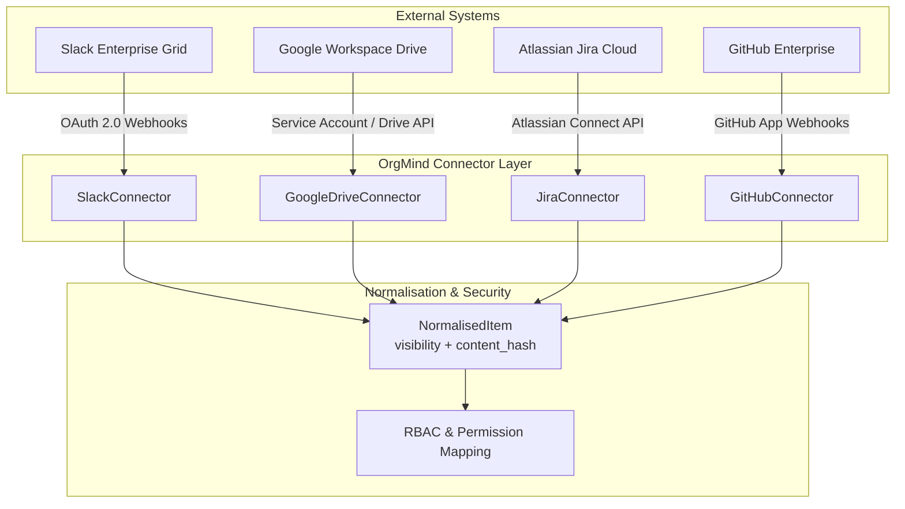

# OrgMind Connector Contract & Integration Specifications

**Document Version**: 1.0.0  
**Status**: APPROVED  
**Architecture Layer**: Ingestion Service (`packages/core/orgmind/ingest/connectors/`)

---

## 1. Executive Overview

OrgMind ingests heterogeneous enterprise information into an unified, queryable corporate knowledge graph. To maintain security, auditability, and deterministic reproducibility, all data ingestion is abstracted behind a standardized **Connector Contract**.

### Global Guarantees Enforced by Connectors
1. **Zero Secret Leaks**: Secrets and authorization tokens are strictly retrieved via environment variables or secret vaults. No tokens are written to graph nodes or persisted in review queues.
2. **Cryptographic Content Hashing**: Every raw payload is SHA-256 hashed (`content_hash`). If the hash matches an existing graph Source node, ingestion halts with `noop_idempotent` (zero writes).
3. **Explicit Visibility Enforcement**: Ingested sources carry fine-grained ACLs (`visibility: ["all"]` or `["Admin", "Auditor"]`) determined during normalisation.
4. **Untrusted Data Isolation**: Text content is treated as untrusted data and wrapped in boundary delimiters before model extraction.

---

## 2. Connector Interface Contract

Every OrgMind connector inherits from `BaseConnector` (`orgmind.ingest.connectors.base.BaseConnector`) and implements three core asynchronous methods:

```python
from abc import ABC, abstractmethod
from datetime import datetime
from orgmind.ingest.connectors.base import ConnectorItem, RawPayload, NormalisedItem

class BaseConnector(ABC):
    """Abstract interface contract for all OrgMind data connectors."""

    connector_type: str = "base"

    def __init__(self, config: dict | None = None) -> None:
        self.config = config or {}

    @abstractmethod
    def list_changes(self, since: datetime | None = None) -> list[ConnectorItem]:
        """Lists items created or modified since the specified timestamp.
        If since is None, performs a full initial catalog listing.
        """
        pass

    @abstractmethod
    def fetch(self, item: ConnectorItem) -> RawPayload:
        """Fetches the raw file or message payload for the specified item."""
        pass

    @abstractmethod
    def normalise(self, payload: RawPayload) -> NormalisedItem:
        """Normalises the raw payload into a standard NormalisedItem.
        Extracts plain text, determines visibility ACL, and computes a cryptographic
        content_hash (SHA-256).
        """
        pass
```

### Data Transfer Objects (DTOs)

| DTO | Purpose | Key Attributes |
| :--- | :--- | :--- |
| **`ConnectorItem`** | Reference handle returned by `list_changes` | `id`, `uri`, `modified_at`, `content_hash`, `metadata` |
| **`RawPayload`** | Binary or string content retrieved by `fetch` | `id`, `uri`, `content: bytes \| str`, `content_type`, `metadata` |
| **`NormalisedItem`** | Cleaned text entity ready for chunking & extraction | `id`, `item_type`, `title`, `text`, `uri`, `author_raw`, `visibility`, `content_hash`, `created_at` |

---

## 3. Implemented Connectors (Phase 6)

### 3.1. File Upload Connector (`file_upload`)
- **Module**: `orgmind.ingest.connectors.file_upload.FileUploadConnector`
- **Supported Formats**: Markdown (`.md`), Plain Text (`.txt`), Adobe PDF (`.pdf`).
- **Parsing Strategy**:
  - **Markdown**: Parses YAML frontmatter if present; extracts `# Title`, `author`, and `visibility: [roles]`.
  - **PDF**: Page-by-page text extraction via `pypdf.PdfReader` with defensive error handling for encrypted or damaged documents.
  - **Text**: UTF-8 decoding with Latin-1 fallback.

### 3.2. Watched Folder Connector (`watched_folder`)
- **Module**: `orgmind.ingest.connectors.watched_folder.WatchedFolderConnector`
- **Config**: `watch_dir: "data/watched"`
- **Operation**: Periodically polls the designated local directory for file modifications (`st_mtime > since`), streaming detected additions to the ingestion pipeline.

### 3.3. Sample Data Connector (`sample_data`)
- **Module**: `orgmind.ingest.connectors.sample_data.SampleDataConnector`
- **Operation**: Bootstraps the company graph from the planted story files (`data/docs/`, `data/chat/`, `data/tickets.json`, `data/people.csv`).

---

## 4. Future Connector Specifications & Architecture

The following connectors are fully architected and ready for implementation in subsequent milestones.



### 4.1. Slack Enterprise Connector (`slack`)
- **Authentication**: Slack OAuth 2.0 App with `bot` and `user` tokens. Requires `channels:history`, `groups:history`, `users:read`, `users:read.email`.
- **Sync Model**:
  - Initial backfill: `conversations.list` and `conversations.history` with cursor pagination.
  - Real-time incremental sync: Slack Events API webhooks (`message.channels`, `message.groups`).
- **Permission & Visibility Mapping**:
  - **Public Channels (`#general`, `#engineering`)**: `visibility: ["all"]`
  - **Private Channels (`#exec-team`, `#legal`)**: `visibility: ["Admin", "Auditor"]` (or scoped workspace group IDs).
  - Messages in private channels are never visible to general Viewers.

### 4.2. Google Drive Connector (`google_drive`)
- **Authentication**: Google Cloud OAuth 2.0 with offline access (`access_type=offline`) or Service Account with Domain-Wide Delegation. Scope: `https://www.googleapis.com/auth/drive.readonly`.
- **Sync Model**:
  - Incremental sync via Drive Changes API (`drive.changes.list(pageToken)`).
- **Export & Extraction**:
  - Google Docs exported via `drive.files.export(mimeType='text/plain')`.
  - Native PDFs and `.docx` streamed to `pypdf` / binary parsers.
- **Permission & Visibility Mapping**:
  - Reads Drive permissions API (`drive.permissions.list`).
  - Files shared with "Anyone at Northwind" -> `visibility: ["all"]`.
  - Restricted files -> `visibility: ["Admin"]` or specific group email domains.

### 4.3. Atlassian Jira Cloud Connector (`jira`)
- **Authentication**: Atlassian OAuth 2.0 (3LO) or API Token via Atlassian Cloud REST API v3.
- **Sync Model**:
  - JQL incremental queries: `project in (...) AND updated >= '$since' ORDER BY updated ASC`.
  - Webhook dispatch on `jira:issue_created` and `jira:issue_updated`.
- **Permission & Visibility Mapping**:
  - Projects with default browse permissions -> `visibility: ["all"]`.
  - Security-level tickets (e.g. `Security Level: Internal Only`) -> `visibility: ["Admin", "Auditor"]`.

### 4.4. GitHub Enterprise Connector (`github`)
- **Authentication**: GitHub App with installation token (`repo:read`, `issues:read`, `pull_requests:read`).
- **Sync Model**:
  - GitHub Webhooks for real-time events (`issues`, `pull_request`, `push`).
  - GitHub REST API `/repos/{owner}/{repo}/commits` for change history.
- **Permission & Visibility Mapping**:
  - Public repository code and issues -> `visibility: ["all"]`.
  - Private security advisories / private repositories -> mapped to team maintainers and `Admin`.

---

## 5. Security & Verification Requirements
- Every connector MUST compute the SHA-256 hash over raw content before returning `NormalisedItem`.
- Re-fetching the identical document MUST yield an identical `content_hash`.
- No raw Cypher or graph writes are executed directly by connectors; all writes pass through the central `IngestionPipeline`.
